<h1>
  <picture>
    <source media="(prefers-color-scheme: dark)" srcset="Data/Branding/assiduous-logo.svg">
    
  </picture>
</h1>

A modern C++23 game engine and editor built entirely with C++ modules. It provides a complete game
development ecosystem, combining an integrated editor, asset pipeline, runtime, and toolchain with
advanced rendering, gameplay scripting, and a comprehensive UI framework. Its agentic workflow
enables AI agents to build entire games, from initial project setup to fully playable experiences.

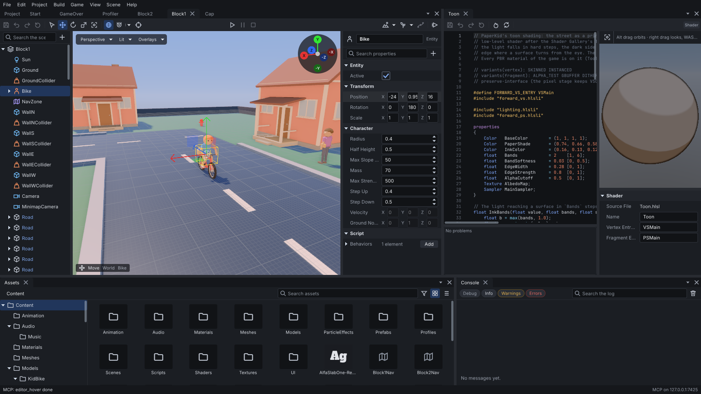

## Features

- **C++23 modules throughout:** every library is a named module, with no public headers.
- **Rendering hardware interface (RHI)** with Vulkan 1.3 (primary), WebGPU (desktop through
  wgpu-native, and the browser) and Direct3D 12 backends.
- **Renderer:** a render graph driving forward PBR with a depth prepass and clustered lights;
  cascaded sun shadows and shadowed point and spot lights; image-based lighting and reflection
  probes; decals, sprites, particles, skinned and instanced meshes; render textures for in-game
  cameras.
- **Post-processing:** ambient occlusion, SSR, screen-space GI, bloom, TAA, MSAA, FXAA, auto
  exposure and colour grading. A game sets them in shared environment and post profiles.
- **Shaders:** HLSL compiled through DXC, cross-compiled to WGSL for the web, cooked into packs,
  and custom shaders per project.
- **Scene system:** entities with hierarchical transforms, component managers per domain,
  prefabs with overrides, and scene serialization.
- **Gameplay systems:** physics (Jolt), navigation (Recast/Detour), audio (miniaudio, buses
  with effect chains), input maps, save data, splines, terrain and vegetation.
- **Animation:** skeletal clips, animation graphs, IK, root motion and property animation.
- **Networking** with state replication.
- **Scripting** in AngelScript or Luau over the engine's reflected facades: behaviours per entity,
  a level script per scene and a game script per run, with coroutines, events and an in-editor
  debugger.
- **UI:** a retained-mode GUI with flex, grid and stack layouts, `.xml` markup, CSS sheets
  (cascade, variables, transitions, animations, media queries), shaped bidirectional text,
  keyboard and gamepad navigation, data binding, world-space UI, and a game kit for screens and
  prompts. Scripts can create and control any widget.
- **Vector graphics and fonts:** a vector graphics layer with SVG, and distance field and
  coverage fonts.
- **Editor** (`Tools.Editor`): project manager, scene hierarchy, viewport with gizmos and
  per-domain tools (terrain sculpting and painting, vegetation, splines), inspectors from
  reflection, an asset browser, undo and redo, play in editor (several instances side by side),
  and a page per asset type.
- **Asset pipeline:** importers for glTF, FBX, OBJ, images, audio and fonts; cooks per asset
  type; BC7 and ASTC texture compression.
- **Export** to the desktop player, the web (WebAssembly with WebGPU) and the Steam Deck, from
  per-target presets and player templates. Headless tools can run all of it from the command
  line.
- **Agent tooling:** an MCP host (`Tools.Mcp`) exposes the engine's reflection, the script API
  and project operations (import, cook, scene validation, export, health checks). The editor
  serves the same tools over HTTP for its open project, plus its pages and play in editor, where
  an agent plays the game with scripted input and reads back probes and screenshots.
  [AGENTS.md](AGENTS.md) describes how an agent works on the engine itself.
- **Samples:** five sample games and a custom shaders gallery (below), and low-level C++ samples
  per engine area.

## Building

See [Documentation/BUILDING.md](Documentation/BUILDING.md) for the requirements, the presets and
how to run the editor.

## Sample projects

Game projects under `Data/SampleProjects/`, opened from the editor's project manager. The five
games and the Shader Gallery were built through the engine's MCP tools.
[The website](https://assiduousengine.github.io/#games) plays them in a browser and has their
Windows, Linux and Steam Deck downloads (the Shader Gallery has no Steam Deck build).

**Sky Hopper** (`PlatformerGame`) is a small 3D platformer, played through to the end over the
MCP tools by an AI agent while it was built: five levels, coins, enemies and hazards, three lives
with stars and best scores saved, menus with volume settings, music and effects, and gamepad
support throughout.

| Title | Level 1 | Settings |
|:---:|:---:|:---:|
| 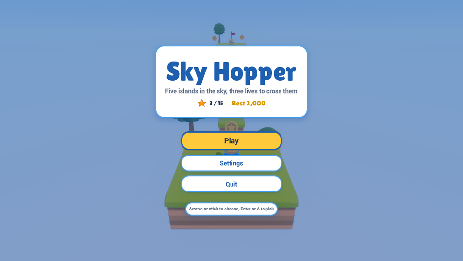 | 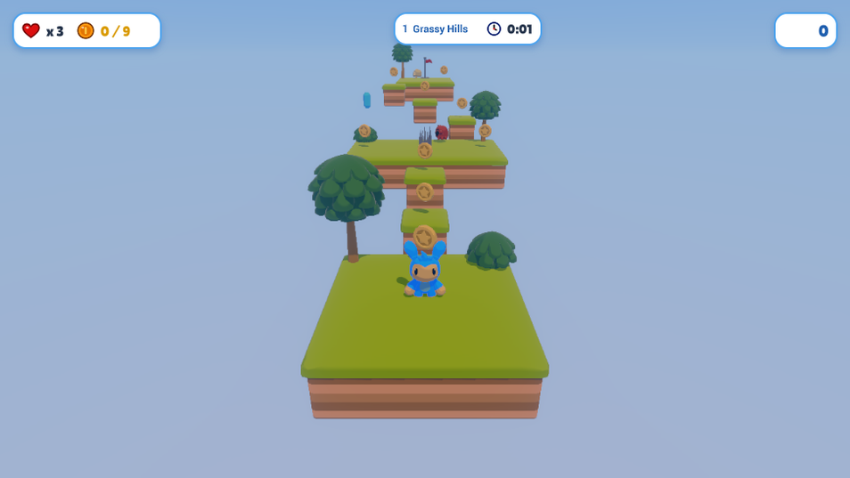 | 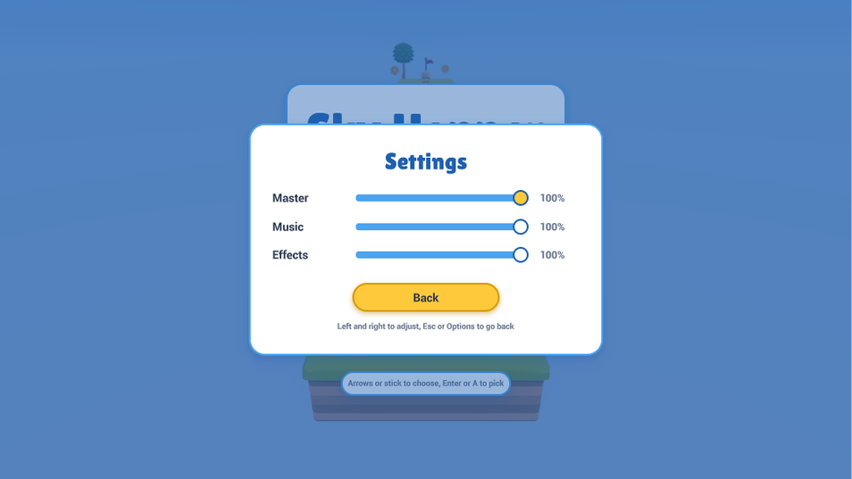 |

**PaperKid** is an arcade paper-route game: five town blocks on a difficulty ramp, papers thrown
with a soft auto-aim, traffic and pedestrians on the navmesh, lives, a live minimap drawn by a
top-down camera into a render texture, particle effects, a newsprint UI theme, and music that
speeds up when the clock runs low. Its kid, bike, town and people are modelled, rigged and
animated by Blender scripts.

| Title | Riding a block | Block cleared |
|:---:|:---:|:---:|
| 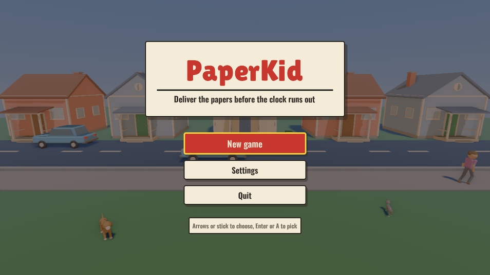 | 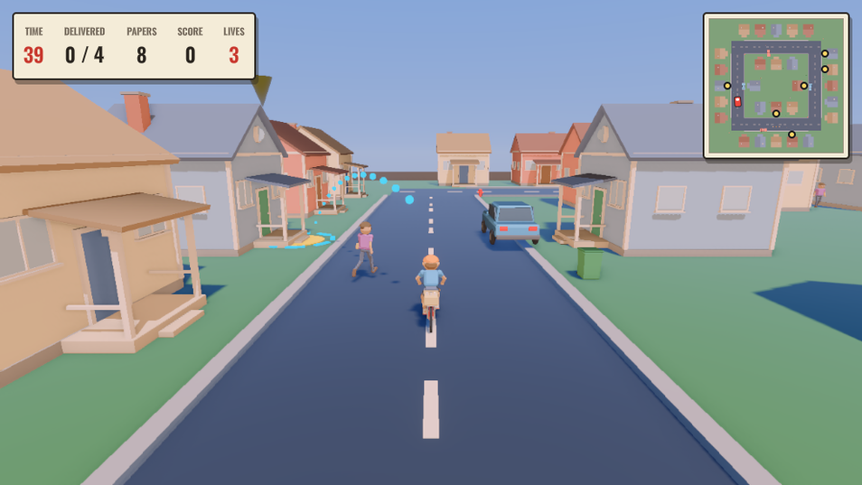 | 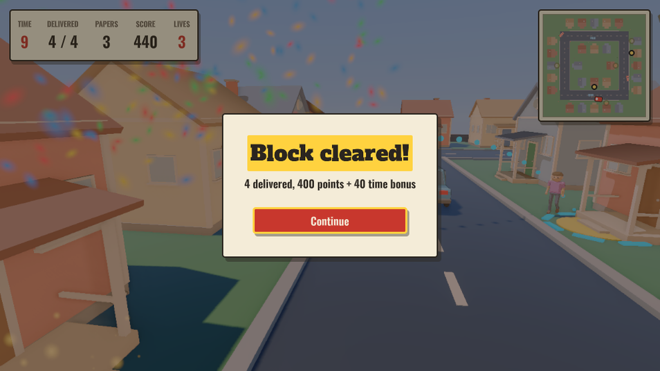 |

Watch it played on a Steam Deck: [PaperKid gameplay video](https://youtu.be/syJlmIirg_o).

**Snowline** is a snowboard time trial with tricks. It shows generated terrain with splat-painted
snow, rock and forest, scattered vegetation whose trees are solid, splines for the course line and
the medal ghosts, an animation graph the rider drives by parameters, decals for its tracks, and
jointed slalom flags. Three courses opened by medals: Meadow, Forest with its shortcut through the
trees, and Ridge with a run of kickers, a gap over a crevasse and an avalanche chasing down the last
stretch. Spins and grabs score on a combo, and your best run rides beside you as a ghost. The rider
is modelled, rigged and animated by Blender scripts.

| Courses | Ridge, past the gap | A run's results |
|:---:|:---:|:---:|
| 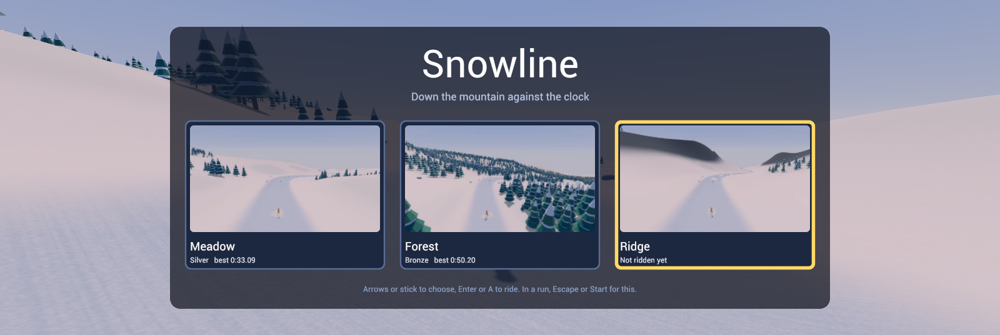 | 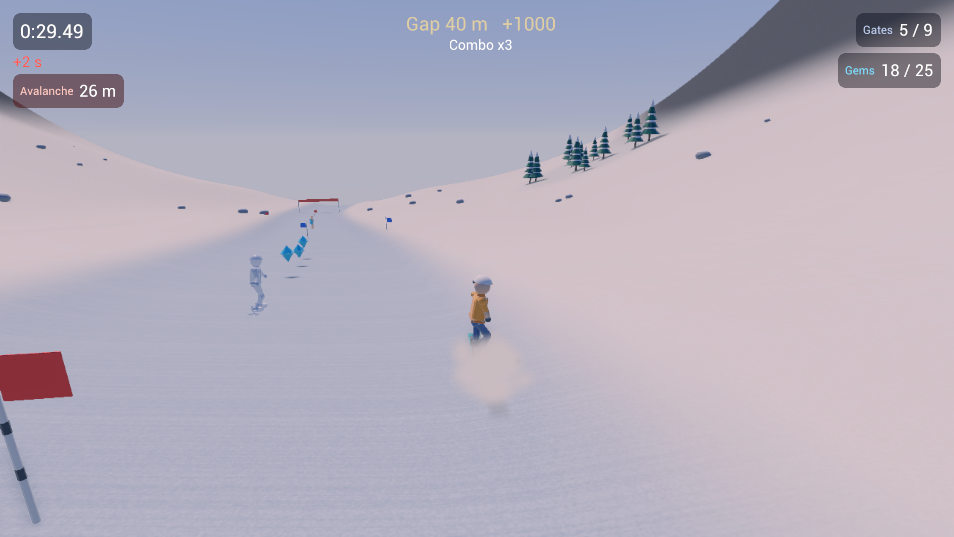 | 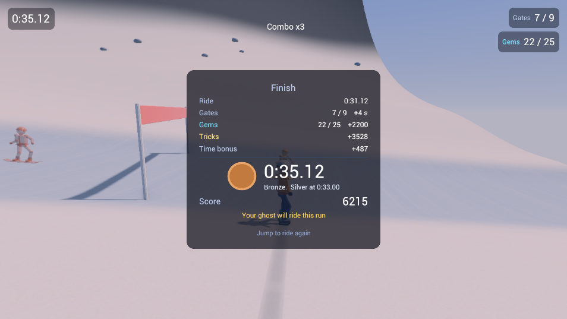 |

Watch it played on a Steam Deck: [Snowline gameplay video](https://youtu.be/vlxxLiMEzp0).

**Lamplight** is a night-time manor heist in pure stealth. It shows lamplight and lantern shadows, a
light meter that reads the renderer's own lights (a guard's eye reads the same), guards on
navigation rounds who see by their lantern's cone, hear footsteps on each surface and come to a
thrown pebble, doors and gates to pick, walls that dither away between the camera and the thief,
rain, reverb per room, and auto exposure from moonlit grounds into torch-lit cellars. Five levels,
from the gardens to the vault on the upper floor, with checkpoints, loot, an alarm, and a ghost
medal for never being seen. Everything in it, the thief and the guards included, is built by
scripts: Blender for the models, a level generator for the scenes, generated sounds.

| The Gardens | The Ground Floor | Away like a ghost |
|:---:|:---:|:---:|
| 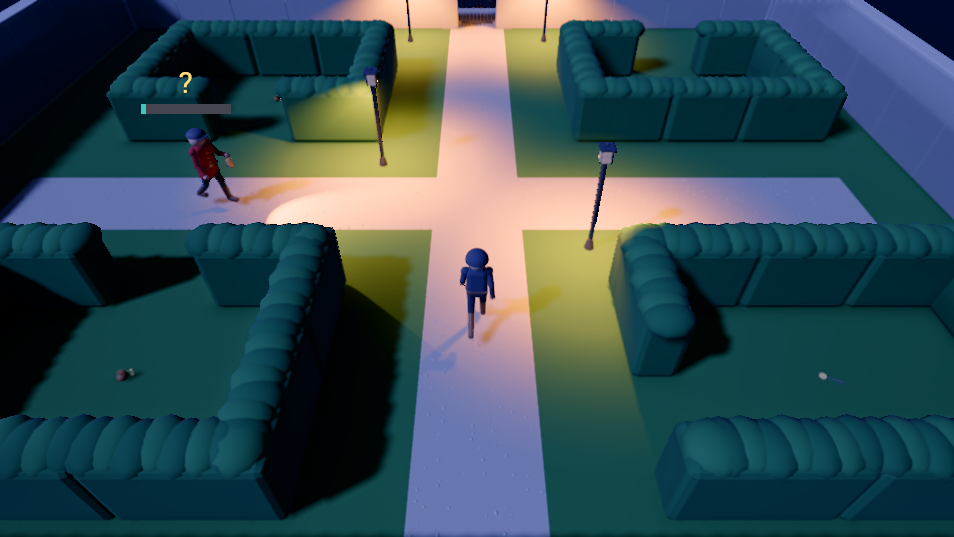 | 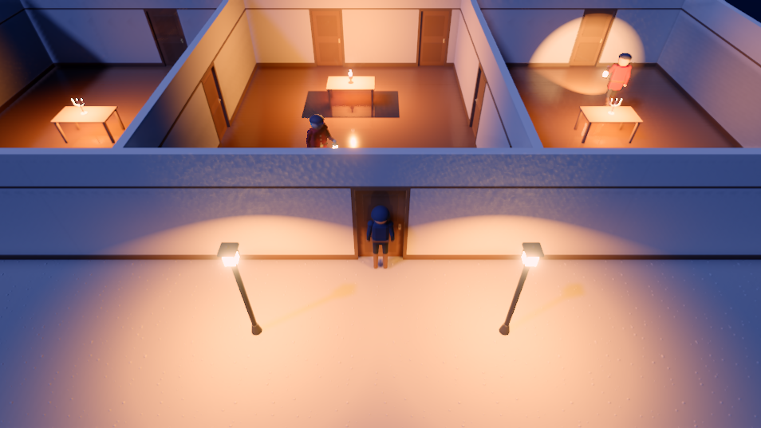 | 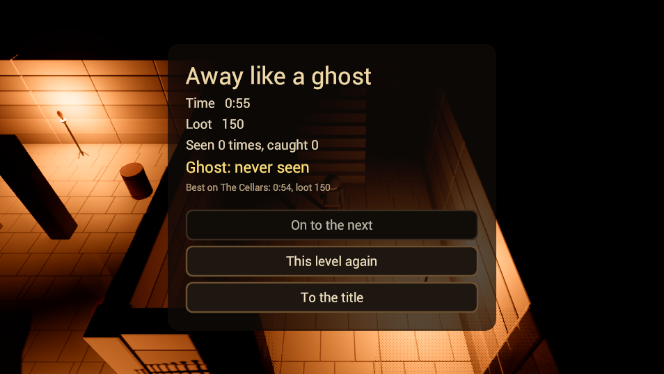 |

**Masquerade** is social stealth at a masked ball, alone against bots or with up to four players
over the network, chosen to show the network stack and crowds: an authoritative host that plays
and players joining it natively, replicated script state, and some 150 guests on navigation drawn
as instances of six costumes. Each hunter is given a mark, a guest in one of those costumes, and is
someone else's mark; guests stroll, gather and dance to the orchestra's cues, and a hunter who
sprints or stands still through a dance stands out. Three maps: the Palace, the Canal with its
gondolas, and the Gardens. Masks and silk on custom shaders, music the crowd follows, and the
models, the music and the sounds all made by its scripts. More in
[its README](Data/SampleProjects/Masquerade/README.md).

| The title | On the Canal | The music stops |
|:---:|:---:|:---:|
| 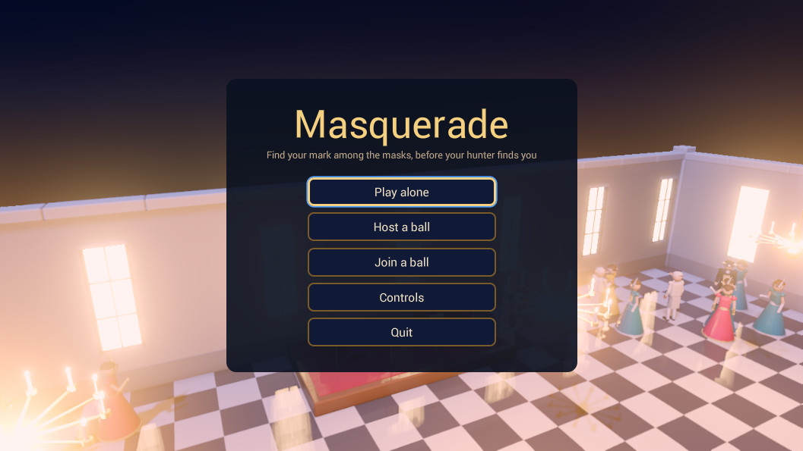 | 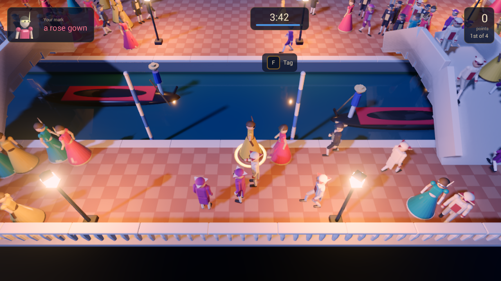 | 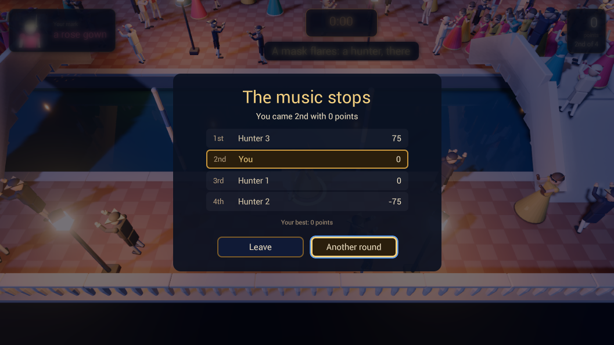 |

**Shader Gallery** (`ShaderGallery`) is the custom shaders sample: a hall of lesson shaders to
fly through, each on its own plinth, each `.hlsl` a short commented lesson that builds on the one
before. Surface shaders first (unlit colour, textures, lava, a hologram, triplanar rock, dissolve,
waves, wind and the engine's own PBR written as a surface), then two low-level shaders that light
themselves: toon bands, and lighting that walks the scene's lights. Its lessons are listed in
[its README](Data/SampleProjects/ShaderGallery/README.md).

| The hall | Hologram | Dissolve | Toon |
|:---:|:---:|:---:|:---:|
|  |  |  |  |

**NativeSample** is the reference for a game with native C++ code beside its scripts.

## Platform support

- **Linux and Windows:** the development platforms; the editor and the player run on both.
- **Web:** games export to the browser as WebAssembly with WebGPU.
- **Steam Deck:** games export through a Deck player template, built in a container by
  `scripts/build-steamdeck.sh`.

## Community

Join the [Discord](https://discord.gg/WSvxW8mWH5) for discussion and support.

## Inspiration

The engine draws inspiration from [ezEngine](https://github.com/ezEngine/ezEngine),
[LumixEngine](https://github.com/nem0/LumixEngine) and [Traktor](https://github.com/apistol78/traktor).

## License

MIT. See [LICENSE](LICENSE). The AssiduousEngine name and logo are not: they stay the project's
own, under the terms in [Data/Branding/LICENSE.txt](Data/Branding/LICENSE.txt).
